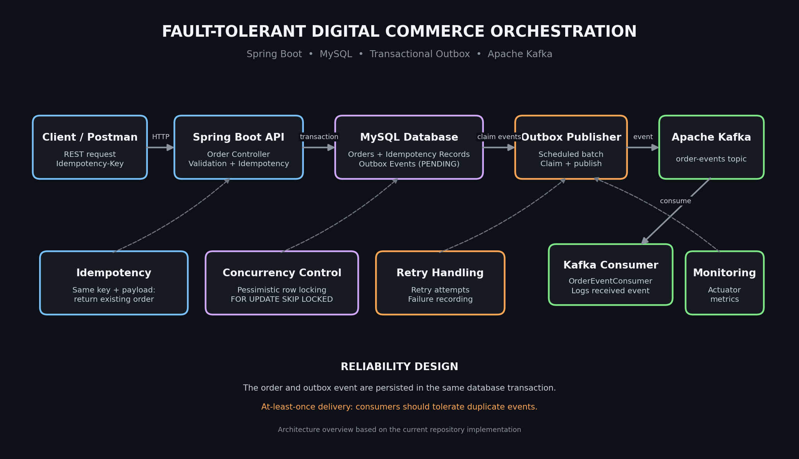

# Fault-Tolerant Digital Commerce Orchestration Platform
## System Architecture



A backend-focused, event-driven commerce platform built using Java 21, Spring Boot, MySQL, and Apache Kafka. The system demonstrates reliable order creation, idempotency, transactional event publishing, concurrency control, and retry handling.

## Project Overview

This project explores backend engineering patterns used in distributed commerce systems.

It provides REST APIs for order management and uses a Transactional Outbox architecture to reliably publish order events to Apache Kafka.

The implementation focuses on consistency, fault tolerance, duplicate prevention, and safe concurrent processing.

## Technology Stack

- **Language:** Java 21
- **Framework:** Spring Boot 4.1.1
- **Build Tool:** Maven
- **Database:** MySQL 8
- **Persistence:** Spring Data JPA / Hibernate
- **Messaging:** Apache Kafka 4.1.0
- **JSON:** Jackson 3
- **Monitoring:** Spring Boot Actuator and Micrometer
- **Testing:** JUnit 5, Spring Boot Test
- **Containerization:** Docker Compose

## Architecture

```text
                 Client / Postman
                        |
                        v
                 Spring Boot REST API
                        |
                        v
                Idempotency Service
                        |
             Single Database Transaction
                        |
             +----------+----------+
             |                     |
             v                     v
         Orders Table       Outbox Events Table
                                   |
                                   v
                           Outbox Publisher
                                   |
                            Claim Event Batch
                                   |
                         Apache Kafka Broker
                                   |
                                   v
                           Kafka Consumer
```

## Key Engineering Features

### 1. Idempotent Order Creation

- Requires an `Idempotency-Key` for order creation.
- Prevents duplicate orders when clients retry requests.
- Rejects reuse of an idempotency key with a different request payload.
- Uses database-backed idempotency records.

### 2. Transactional Outbox Pattern

Order creation and outbox event persistence happen within the same database transaction.

This avoids the dual-write problem of independently committing an order and publishing its event.

The background publisher:

1. Claims pending outbox events.
2. Publishes them to Kafka.
3. Waits for Kafka acknowledgement.
4. Marks successfully published events as `PUBLISHED`.
5. Records failures for retry.

### 3. Concurrent Event Claiming

The outbox implementation includes:

- Database pessimistic locking.
- MySQL `FOR UPDATE SKIP LOCKED`.
- Publisher ownership identifiers.
- Time-based leases.
- Expired claim recovery.
- Ownership-checked status updates.

This allows multiple publisher workers to claim different events without intentionally processing the same locked event.

### 4. Retry and Failure Handling

- Configurable retry attempts.
- Exponential backoff.
- Temporary payment failure simulation.
- Persistent failure tracking.
- Retry-related application metrics.

### 5. Order Lifecycle Management

Orders support the following states:

`PENDING → PROCESSING → COMPLETED`

Orders can also transition to `FAILED` when processing cannot complete.

Invalid state transitions are rejected.

### 6. Monitoring

Spring Boot Actuator exposes configured endpoints for:

- Health
- Application information
- Metrics

Retry metrics include:

- `commerce.retry.attempts`
- `commerce.retry.success.after.retry`
- `commerce.retry.exhausted`

## API Endpoints

| Method | Endpoint | Description |
|---|---|---|
| POST | `/api/orders` | Create an order |
| GET | `/api/orders` | Retrieve orders |
| GET | `/api/orders/{id}` | Retrieve an order |
| POST | `/api/orders/{id}/process` | Process an order |
| POST | `/api/orders/{id}/complete` | Complete an order |
| POST | `/api/orders/{id}/fail` | Mark an order as failed |

### Create an Order

**Request**

`POST /api/orders`

Headers:

```text
Content-Type: application/json
Idempotency-Key: demo-order-001
```

Body:

```json
{
  "productName": "Test Laptop",
  "quantity": 1
}
```

A successful new order returns `201 Created`.

Reusing the same idempotency key and payload returns the existing order rather than creating another one.

## Local Setup

### Prerequisites

- Java 21
- Maven
- MySQL 8
- Docker Desktop

### 1. Clone the Repository

```bash
git clone https://github.com/dhanush29122003/commerce-orchestrator.git
cd commerce-orchestrator
```

### 2. Create the MySQL Database

```sql
CREATE DATABASE commerce_orchestrator;
```

### 3. Configure Environment Variables

PowerShell:

```powershell
$env:DB_USERNAME = "root"
$env:DB_PASSWORD = Read-Host "Enter your MySQL password"
```

Do not commit actual database credentials.

### 4. Start Kafka

```bash
docker compose up -d kafka
```

### 5. Run the Application

```bash
mvn spring-boot:run
```

The API runs on:

`http://localhost:8080`

### 6. Run Automated Tests

Set the database environment variables in the terminal, then execute:

```bash
mvn clean test
```

The project has successfully completed a full regression run with **42 tests, zero failures, and zero errors**.

## Reliability Considerations

The outbox publisher uses at-least-once delivery semantics.

A Kafka acknowledgement followed by a failed database status update, or an expired lease during publishing, can result in duplicate delivery.

Consumers should therefore implement idempotent processing.

## Future Improvements

- Dockerize the Spring Boot application and MySQL database.
- Add automated CI/CD using GitHub Actions.
- Add consumer-side idempotency and duplicate-event protection.
- Add dead-letter handling and operational recovery tools.
- Improve observability with distributed tracing.
- Deploy the application to a cloud environment.

## Author

**Dhanush**

Java | Spring Boot | Backend Engineering | SQL | Apache Kafka

GitHub: https://github.com/dhanush29122003